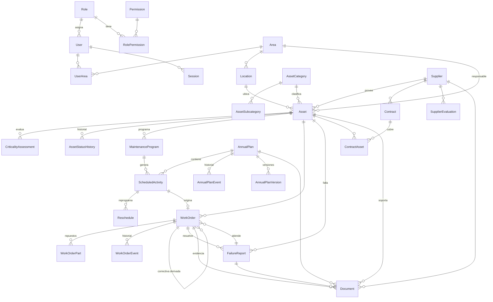

# 3. Manual técnico

## 3.1 Arquitectura

```
Navegador (red interna) ──HTTPS──► Nginx (web) ──/api──► NestJS (api) ──► PostgreSQL 18 (db)
                                     │ SPA Vue 3              │ almacenamiento privado (volumen storage)
                                                              └─ backup (pg_dump + verificación + restauración de prueba)
```

- **Monolito modular** NestJS: `auth`, `users`, `catalog`, `assets` (+ criticidad), `programs`, `plans` (generador, flujo documental, reprogramación, exportaciones), `workorders`, `failures`, `documents`, `suppliers`, `lifecycle`, `dashboard` (indicadores), `reports` (F-01 a F-12), `procedures`, `audit`, `health`.
- **Servicios transversales** (`src/common`):
  - `PrismaService` (adaptador `pg`, sesión en America/Bogota).
  - `AuditService` (bitácora en la misma transacción que la operación).
  - `CountersService` (consecutivos sin colisiones con `INSERT … ON CONFLICT … RETURNING`).
  - `SettingsService`, `StorageService` (archivos privados con verificación de tipo real) e `InstitutionalPdf` (jsPDF + AutoTable).
- **Validación**: esquemas Zod en cada endpoint (`ZodPipe`), con documentación Swagger derivada de esos esquemas.
- **Errores**: filtro global `AllExceptionsFilter` con mensajes en español. Mapea errores de Prisma y de *triggers* (409, 404, 503) y no expone detalles internos.
- **Logs**: pino en JSON, con redacción de cookies y tokens.

## 3.2 Modelo de datos

Convenciones: las fechas de programación son `DATE`; las marcas de auditoría, `TIMESTAMPTZ`; los montos, `NUMERIC(14,2)` en COP; los identificadores, UUID. No hay borrado físico de registros históricos.



Tablas independientes: `settings`, `counters`, `login_attempts`, `criticality_criteria`, `document_formats`, `procedures`, `audit_logs`, `backup_runs`. El esquema completo está en `backend/prisma/schema.prisma` y las migraciones en `backend/prisma/migrations/`.

### Integridad en la base de datos (migración `integrity`)
- `audit_logs`, `work_order_events`, `annual_plan_events`, `annual_plan_versions` y `asset_status_history` son **inmutables**: rechazan UPDATE, DELETE y TRUNCATE.
- `work_orders`, `failure_reports`, `scheduled_activities`, `reschedules` y `annual_plans` **no admiten DELETE**.
- `assets` con historial no se pueden eliminar.
- `scheduled_activities.originalDate` no se puede modificar cuando el plan está aprobado o cerrado.
- Restricciones CHECK: costos ≥ 0, finalización ≥ inicio, justificación de cancelación, intervalos personalizados válidos, vigencias de contratos, año del plan y pesos de criterios.
- Índices únicos: código de activo, consecutivos de OT y de fallas, (plan, programa, fecha calculada) para la idempotencia del cronograma, y año del plan.

## 3.3 Reglas de negocio clave

### Generador del cronograma (`plans/recurrence.ts`, `plans.service.ts#generate`)
- **Recurrencia**: las fechas se calculan desde la **fecha base** como *k × paso*, sin acumular desfases. Una base 31/01 mensual da 28/02 (29 en bisiesto), 31/03, 30/04, etc. Solo se generan fechas dentro de la vigencia del programa, y "fechas específicas" (MM-DD) se repite cada año.
- **Transacción y concurrencia**: la generación corre en una transacción con *advisory lock* por año, de modo que dos ejecuciones simultáneas no duplican.
- **Idempotencia**: está garantizada por el índice único `(planId, programId, periodKey)`.
- **Según el estado del plan**:
  - **Borrador**: crea lo faltante; marca *No aplica* (sin borrar) las fechas que dejaron de corresponder y reactiva las que vuelven a corresponder.
  - **Aprobado**: solo agrega programas nuevos, marcados `addedAfterApproval`. Exige justificación e incrementa la versión.
  - **En revisión / Cerrado**: no permite generar.
- **Exclusiones**: no se generan fechas para activos retirados o dados de baja, ni para fechas posteriores a la baja.
- **Instantánea**: cada actividad guarda una copia del programa (`programSnapshot`), de modo que cambiar un programa no altera planes aprobados de años anteriores.
- **Año actual**: se calcula con la fecha del servidor en America/Bogota (`GET /plans/current-year`).

### Estados
- **Estados guardados**: Programado, En ejecución, Ejecutado, Reprogramado, Cancelado, No aplica.
- **Calculados con la fecha de Bogotá**:
  - *Vencido*: fecha comprometida anterior a hoy.
  - *Próximo*: dentro de `schedule.upcomingDays` días.

### Reprogramación
Se conservan **fecha originalmente aprobada**, **fecha comprometida** y **fecha real de ejecución**.
- **Plan en borrador**: el ajuste se aplica de inmediato y queda registrado.
- **Plan aprobado**: la solicitud queda pendiente y su aprobación (`plans.approve`) incrementa la versión con una instantánea.

### Órdenes de trabajo
- **Transiciones** controladas por `WO_TRANSITIONS`, con bloqueo de fila `FOR UPDATE`.
- **Validación**: verifica campos obligatorios distintos para preventivas y correctivas.
- **Cierre**:
  - Segregación ejecutor/validador.
  - Si el activo es crítico, exige competencia técnica y el permiso `failures.release`.
  - Marca la actividad preventiva como *Ejecutada* con su fecha real, actualiza el estado del activo y resuelve la falla con autorización de liberación y fin de indisponibilidad.
  - Una orden correctiva **no** marca como cumplida ninguna actividad preventiva.

### Prioridad de fallas
Puntaje 1-5 ponderado con los criterios seguridad, impacto asistencial, continuidad y criticidad del activo; pesos y umbrales son configurables. Con el parámetro activo, el impacto máximo en seguridad fuerza la prioridad URGENTE.

### Indicadores (`dashboard/indicators.service.ts`)
- **Cumplimiento** = ejecutadas a tiempo / exigibles × 100.
  - *Exigibles*: fecha de referencia entre el inicio del periodo y la fecha de corte (mínimo entre fin del periodo y hoy).
  - *A tiempo*: ejecutada a más tardar el último día del mes de referencia.
  - Canceladas y No aplica se excluyen y se informan aparte.
  - **Base**: usa la fecha original, solo de planes aprobados y sin actividades agregadas después de la aprobación.
  - **Reprogramado**: usa la fecha comprometida.
- **Tiempos**: respuesta (reporte → primera respuesta), reparación (inicio → fin de la OT correctiva), solución (reporte → resuelta) e indisponibilidad (intervalos completos; los abiertos se informan como "en curso").
- **Reincidencia**: activos con 2 o más fallas / activos con fallas.
- Sin datos suficientes, el sistema devuelve `insufficient: true` en lugar de calcular.

## 3.4 API

- **Base**: `/api/v1`. Documentación interactiva en `/api/docs` (Swagger) y especificación en `docs/openapi.json` (129 operaciones).
- **Autenticación**: `POST /auth/login` emite la cookie `sigm_session` (HttpOnly, Secure, SameSite=Strict) y un token CSRF. Toda operación de escritura debe enviar la cabecera `X-CSRF-Token`.
- **Exportaciones**: `GET /plans/{año}/export.pdf?paper=a4|a3&<filtros>`, `GET /plans/{año}/export.xlsx` (hojas: Resumen anual, Cronograma mensual, Detalle de actividades) y `GET /reports/*.pdf`.

## 3.5 Pruebas

Ver [06-informe-pruebas.md](06-informe-pruebas.md). Las pruebas de API usan una base PostgreSQL efímera creada y eliminada en cada ejecución (`test/global-setup.ts`).

## 3.6 Operación

- **Salud**: `GET /api/v1/health` (verifica la base de datos).
- **Logs**: `docker compose logs api` (JSON).
- **Variables**: ver `.env.example` y `backend/.env.example`.
- **Zona horaria**: `TZ=America/Bogota` en todos los contenedores; la sesión de PostgreSQL usa `timezone=America/Bogota`.
